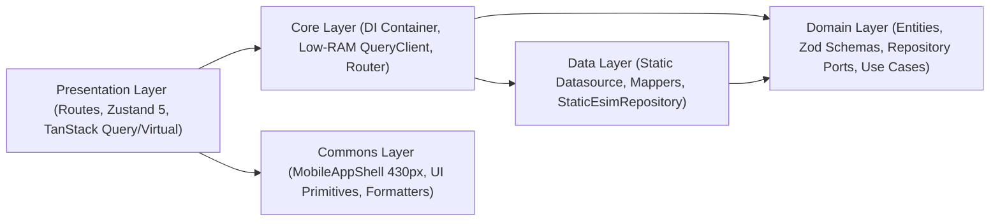

# DESIGN.md — MKP Mobile Travel eSIM & Clean Architecture Boilerplate

## 1. Design Read & Three Dials
> **Design Read:** Reading this as: Mobile-first digital eSIM commerce web app for modern travelers, with a crisp Operate + Persuade hybrid language, leaning toward Tailwind v4 utilities + Plus Jakarta Sans & Geist Mono + restrained tactile motion.

| Dial | Value | Rationale |
| :--- | :---: | :--- |
| **`DESIGN_VARIANCE`** | **5** | Clean mobile-first symmetry where cards, pills, and bottom sheets align tightly within a 430px column. |
| **`MOTION_INTENSITY`** | **4** | Restrained, hardware-accelerated tactile push (`active:scale-[0.98]`) and smooth bottom-sheet transitions without gratuitous loops. |
| **`VISUAL_DENSITY`** | **4** | Breathable whitespace around product imagery, single-line pill actions, and concise metadata badges. |

---

## 2. Overview & User Persona
- **Primary Persona**: Indonesian & international digital travelers (ages 20–45) browsing and purchasing travel eSIM packages directly from a mobile browser or desktop browser without installing a native app.
- **Secondary Persona**: Frontend engineers cloning `anantyan/travel-esim-mobile-clean` as an open-source template for **Ultra-Low Browser RAM** mobile web apps (`React 19 + Vite 6 + TanStack Router/Query v5/Virtual + Zustand v5`).

---

## 3. Locked Mobile Phone Shell (All Viewports)
Regardless of whether the app is opened on a **Mobile (`375px`)**, **Tablet (`768px`)**, **Laptop (`1280px`)**, or **Desktop (`1440px`)** screen, the active interactive canvas remains strictly locked to a slim phone viewport:

- **Outer Canvas Backdrop (`>= 640px`)**: `#EEF0F5` (calm neutral slate tint)
- **Phone Column Container**:
  - `w-full max-w-[430px] mx-auto min-h-[100dvh] bg-white`
  - `relative flex flex-col overflow-x-clip`
  - `sm:border-x sm:border-slate-200/80 sm:shadow-[0_20px_50px_-15px_rgba(15,23,42,0.08)]`
- **Overlay & Bottom Sheet Portal Lock**:
  - Dedicated `#mobile-shell-portal` centered via `fixed inset-y-0 left-1/2 w-full max-w-[430px] -translate-x-1/2` so sticky bottom CTAs and filter bottom sheets never stretch across desktop monitors.
- **Viewport Stability**: Strictly uses `min-h-[100dvh]` (never `h-screen`) to avoid iOS Safari address-bar jump.

---

## 4. Calibrated Color Palette (Figma Travel eSIM + Anti-Slop)
| Token | Hex | Role | Contrast Check |
| :--- | :--- | :--- | :--- |
| `--color-brand-primary` | `#252A86` | Deep Royal Indigo header, active radio, primary CTA pill | `11.2:1` with `#FFFFFF` (WCAG AAA) |
| `--color-brand-hover` | `#1B1F66` | Primary CTA hover & active press state | `13.4:1` with `#FFFFFF` |
| `--color-brand-tint` | `#EEF0FF` | Subtle active chip / badge highlight | High contrast with `#252A86` |
| `--color-backdrop` | `#EEF0F5` | Calm outer desktop canvas behind phone column | Neutral framing |
| `--color-surface` | `#FFFFFF` | Mobile canvas, bottom sheets, product cards | Base light surface |
| `--color-surface-subtle` | `#F8FAFC` | Search input fill / subtle metadata surface | Soft tonal separation |
| `--color-ink-primary` | `#0F172A` | Headings, product titles, tabular prices | `17.8:1` on `#FFFFFF` |
| `--color-ink-muted` | `#64748B` | Region labels, helper text, secondary specs | `4.76:1` on `#FFFFFF` (WCAG AA) |
| `--color-border-subtle` | `#E2E8F0` | Hairline `1px` dividers and card borders | Clean non-heavy separation |

---

## 5. Typographic Hierarchy
- **Primary UI & Display Font**: `Plus Jakarta Sans Variable` (`@fontsource-variable/plus-jakarta-sans`) — self-hosted locally (no external Google Fonts `<link>`).
- **Tabular / Technical Mono Font**: `Geist Mono Variable` (`@fontsource-variable/geist-mono`) — reserved for tabular pricing (`Rp69.000`), quota specs, receipt reference numbers, and architecture telemetry.
- **Banned Fonts**: `Inter`, `Roboto`, `Arial`, `Fraunces`.
- **Line-Height & Wrap Discipline**:
  - Page Header: `text-lg font-bold tracking-tight`
  - Hero / Stage Title: `text-3xl font-bold tracking-tight leading-[1.15]`
  - Body Copy: `text-sm leading-relaxed max-w-[34ch]` (no 6-line paragraph walls).

---

## 6. Anti-Slop Invariants & Component Rules
1. **No Nested Cards-Inside-Cards**: Cards sit directly on `#FFFFFF` or `#F8FAFC` with `1px` subtle border (`border-slate-200/80`) and wide diffused shadow (`0 12px 32px -12px rgba(15,23,42,0.06)`).
2. **No Generic AI Purple-to-Cyan Gradients**: Strictly uses the calibrated `#252A86` Deep Royal Indigo brand color.
3. **Unified Iconography**: Exclusively `@phosphor-icons/react` (`weight="regular"` / `weight="bold"`), zero `lucide-react` mixing, zero hand-rolled decorative SVG illustrations.
4. **Shape Consistency Lock**:
   - Interactive pills, filter chips, and primary CTAs: `rounded-full`
   - Product cards and bottom sheets: `rounded-2xl` / `rounded-t-3xl`
   - Search & form inputs: `rounded-xl`
5. **Single-Line CTA Discipline**: All CTA labels fit on one line (`Terapkan`, `Beli`, `Konfirmasi Beli`, `Bayar Sekarang`). Tactile press uses `active:scale-[0.98] transition-transform duration-150`.

---

## 7. Layout Wireframe & Architecture Diagram

### 7.1 Mobile Shell Wireframe (Phase 1 -> Phase 4)
```text
+-------------------------------------------------------------------+
|  Desktop Outer Backdrop (#EEF0F5)                                 |
|                +-------------------------------+                  |
|                |  Locked Mobile Shell (430px)  |                  |
|                |  bg-white min-h-[100dvh]      |                  |
|                |                               |                  |
|                |  Phase 1:                     |                  |
|                |     [ Centered Hello World ]  |                  |
|                |                               |                  |
|                |  Phase 2-4:                   |                  |
|                |   [ #252A86 Header + Search ] |                  |
|                |   [ Region Chip | Jenis Chip] |                  |
|                |   [ 2-Col eSIM Grid Cards   ] |                  |
|                |   [ Detail -> Pay -> Struk  ] |                  |
|                +-------------------------------+                  |
+-------------------------------------------------------------------+
```

### 7.2 5-Layer Clean Architecture & User Flow (Mermaid)


---

## 8. Responsive Breakpoint Matrix
| Viewport | Target Device | Shell Width | Layout Behavior |
| :--- | :--- | :--- | :--- |
| `375 x 812` | Mobile Phone | `100%` (`375px`) | Full-bleed edge-to-edge mobile UI, zero horizontal overflow. |
| `768 x 1024` | Tablet | `430px` centered | Slim mobile column centered over `#EEF0F5` backdrop. |
| `1440 x 900` | Laptop / Desktop | `430px` centered | Slim mobile column centered over `#EEF0F5` backdrop with soft border & elevation. |
